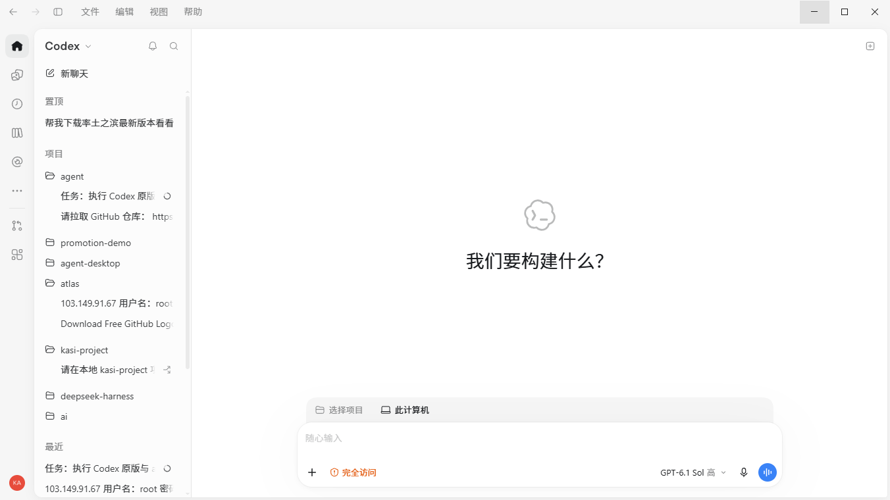
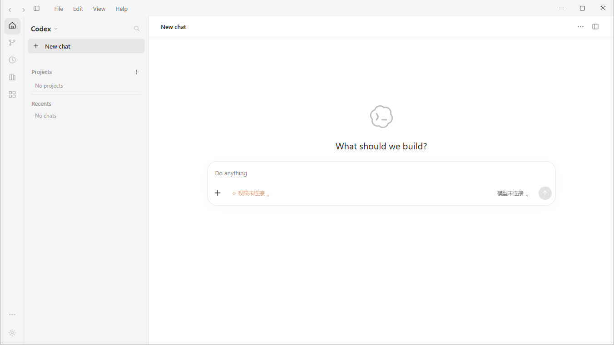
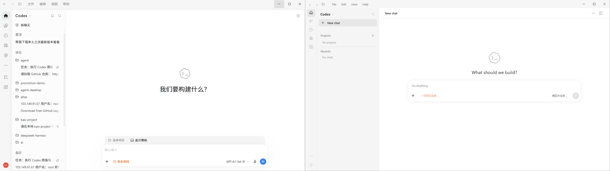
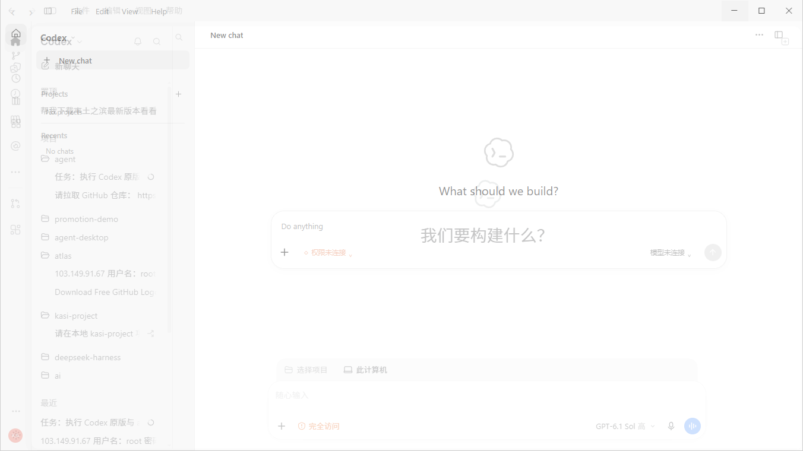
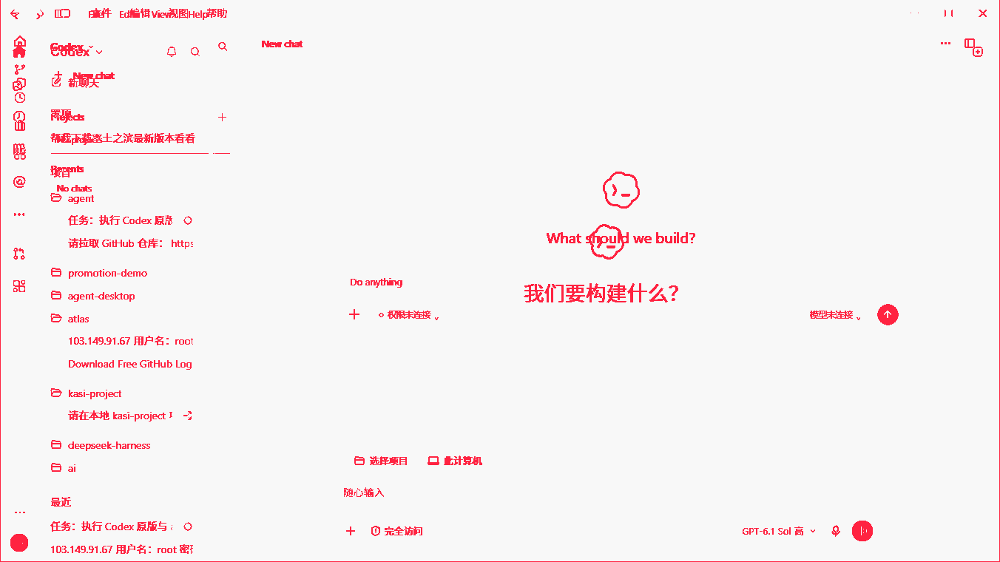

# A-shell-empty — real Windows visual acceptance (2026-10-31)

Real full-window screenshots of official Codex and reconstructed Electron, captured at **1352×760 physical pixels**, **96 DPI / 1×**, **light**, on the same **1920×1080 primary display**, visible origin **(284,160)**. Capture thread: **Per-Monitor V2**. Original images are unchanged. Captured reconstruction source: `64b6178600efec3608baed4604130e529e73e7ae`.

**Capture/comparison succeeded; visual fidelity is not accepted.** Changed pixels above RGB threshold 24: **27,813 / 1,027,520 (2.706809%)**. White backgrounds dominate; this is not a similarity score. Original Chinese UI and saved sidebar history differ from the reconstruction's isolated empty profile and hardcoded English. These content/environment differences are distinguished from geometry and functionality.

The owner explicitly authorized publishing original and derived images unchanged after review of visible project names, chat titles, IP/username fragments and avatar initials. Metadata/report paths were made relative; unnecessary PIDs/window handles removed. No original compiled resources, binaries, profiles or preflight active-chat captures are included.

## Original Codex

[PNG](original-shell-empty.png) · [Capture JSON](original-shell-empty.png.json)

## Reconstructed Electron

[PNG](reconstructed-shell-empty.png) · [Capture JSON](reconstructed-shell-empty.png.json)

## Side-by-side — original left, reconstruction right

[Full-size PNG](comparison/side-by-side.png)

## Overlay

[Full-size PNG](comparison/overlay.png)

## Difference map

[Full-size PNG](comparison/difference.png) · [Comparison JSON](comparison/report.json)

## Findings

- Composer is about **287px too high**; sidebar about **37px too wide**.
- Empty-home toolbar structure, rail icons, text language, typography and spacing differ.
- Project/computer context bar and voice controls are missing.
- Some navigation, model, permission and send functionality remains disconnected; these are not all CSS defects.
- Exact original font metrics, saved sidebar width and differences between referenced source/package versions still need confirmation.

[Full six-region acceptance report and prioritized component/file tasks](VISUAL_ACCEPTANCE_A_SHELL_EMPTY.md)

[Environment and consent](environment.json) · [Verification](verification.json) · [File inventory](FILES.txt) · [SHA-256 manifest](SHA256SUMS.txt)

The report documents the three PowerShell coordinate-expression corrections, test-first failure/pass evidence, Chromium cache mismatch, metadata sanitization and reproduction commands. Run from `packages/codex-frontend-reconstruction`; use `visual:test`, `visual:compare` and `visual:capture:windows` as defined in package.json. PR #89 stays Draft; no UI or agent-cil changes are included.
